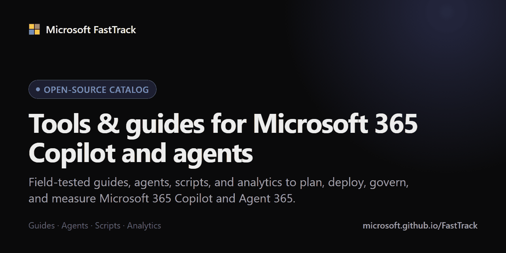

# Microsoft FastTrack open source

**Field-tested guides, agents, scripts, and analytics from Microsoft FastTrack to plan, deploy, govern, and measure Microsoft 365 Copilot and agents.**

## Browse the catalog

The [catalog](https://microsoft.github.io/FastTrack/) is the easiest way to search, filter, and preview everything in this repo.

| Browse | What you will find |
|---|---|
| [Guides & planning](https://microsoft.github.io/FastTrack/?type=strategy) | Interactive implementation guides, decision guides, calculators, and planning templates for Copilot and agent deployments. |
| [Agents](https://microsoft.github.io/FastTrack/?type=agent) | Ready-to-use agents for Copilot Studio, Agent Builder, and GitHub Copilot, plus Employee Self-Service extensions. |
| [Analytics](https://microsoft.github.io/FastTrack/?type=analytics) | Power BI templates, interactive report navigators, and Copilot usage reporting. |
| [Scripts](https://microsoft.github.io/FastTrack/?type=script) | PowerShell scripts and snippets for Microsoft 365 administration, including Teams, Viva Engage, and SharePoint. |

## What is in this repo

| Folder | What you will find |
|---|---|
| [`copilot-agent-strategy/`](copilot-agent-strategy/) | Interactive guides and planning tools, including the Agent 365 guides, the cost calculator, and the agents guide. |
| [`copilot-agent-samples/`](copilot-agent-samples/) | Copilot Studio agents, Agent Builder agents, GitHub Copilot agents and skills, and Employee Self-Service extensions. |
| [`copilot-analytics-samples/`](copilot-analytics-samples/) | Power BI templates, an interactive reports navigator, and an interaction report generator. |
| [`scripts/`](scripts/) | PowerShell scripts for Microsoft 365 administration. Each folder has its own README; retired scripts are kept in [`scripts/archive/`](scripts/archive/). |
| [`samples/`](samples/) | Teams and Viva Engage code samples and snippets. |
| [`tools/`](tools/) | [SimpleGraph](tools/SimpleGraph/) (a lightweight Microsoft Graph wrapper for PowerShell) and the [catalog build tooling](tools/catalog-build/). |
| [`docs/`](docs/) | The [catalog metadata schema](docs/CATALOG-METADATA.md) used by every resource README. |
| [`copilot-prompt-samples/`](copilot-prompt-samples/) | Archived. See [PnP Copilot Prompts](https://pnp.github.io/copilot-prompts/) for a maintained prompt library. |

`catalog.json`, `r/`, `sitemap.xml`, `feed.xml`, and `index.html` power the [catalog site](https://microsoft.github.io/FastTrack/). The first four are generated from each resource's README front matter, so do not edit them by hand. You can follow new and updated resources through the [Atom feed](https://microsoft.github.io/FastTrack/feed.xml).

## Using the resources

Every resource folder has a README that explains what it does, what it needs, and how to run it. Resources are provided as-is, so test them in a non-production tenant first, especially anything that changes or deletes data. Resources marked **Preview** are still maturing, and **Archived** resources are kept for reference only.

## Ideas welcome

If you have ideas that would improve our delivery, experience, or process, [open an issue](https://github.com/microsoft/FastTrack/issues/new/choose) or start a [discussion](https://github.com/microsoft/FastTrack/discussions). We cannot promise every idea will be implemented, but we value your feedback. Please include enough detail for us to understand and respond.

Have a script, agent, or guide that would be valuable to the community? Pull requests are welcome.

## Contributing

Please read [CONTRIBUTING.md](CONTRIBUTING.md) before you start. In short: put your resource in the right folder, start its README from [TEMPLATE-README.md](TEMPLATE-README.md), include the catalog metadata, and keep customer-specific information out. If you have questions, ask in an issue. We would love to talk through your idea first.

## Support statement

The scripts, samples, and tools made available through the FastTrack Open Source initiative are provided as-is. These resources are developed in partnership with the community and do not represent official Microsoft software. As such, support is not available through premier or other Microsoft support channels. If you find an issue or have questions please reach out through the [issues list](https://github.com/microsoft/FastTrack/issues) and we'll do our best to assist, however there is no associated SLA.

## Code of Conduct

This project has adopted the [Microsoft Open Source Code of Conduct](https://opensource.microsoft.com/codeofconduct/).
For more information see the [Code of Conduct FAQ](https://opensource.microsoft.com/codeofconduct/faq/) or
contact [opencode@microsoft.com](mailto:opencode@microsoft.com) with any additional questions or comments.

## Legal Notices

Microsoft and any contributors grant you a license to the Microsoft documentation and other content in this repository under the [MIT License](https://opensource.org/licenses/MIT), see the [LICENSE](LICENSE) file, and grant you a license to any code in the repository under the [MIT License](https://opensource.org/licenses/MIT), see the [LICENSE-CODE](LICENSE-CODE) file.

Microsoft, Windows, Microsoft Azure and/or other Microsoft products and services referenced in the documentation may be either trademarks or registered trademarks of Microsoft in the United States and/or other countries. The licenses for this project do not grant you rights to use any Microsoft names, logos, or trademarks. Microsoft's general trademark guidelines can be found at http://go.microsoft.com/fwlink/?LinkID=254653.

Privacy information can be found at https://privacy.microsoft.com/en-us/

Microsoft and any contributors reserve all others rights, whether under their respective copyrights, patents,
or trademarks, whether by implication, estoppel or otherwise.
